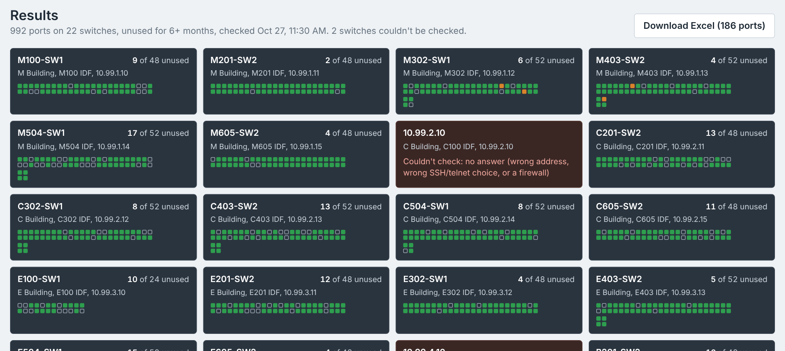

# Port Analyzer

Find switch ports that haven't been used in months, on one switch, one building, or every switch at once, and download the results as an Excel report.

It works with every type of switch on our network: Cisco Catalyst, Cisco Nexus, Dell PowerConnect 5548P and Aruba S3500. It runs on your own computer in your web browser. Nothing is hosted anywhere, and nobody else on the network can reach it.



---

## Install (Windows)

You only do this once.

1. **Install Python 3.12 or newer** from <https://www.python.org/downloads/>.
   On the first installer screen, tick **"Add python.exe to PATH"**.
2. **Get the app**, either way works:
   - With Git, in a Command Prompt:
     ```
     cd %USERPROFILE%\Documents
     git clone https://github.com/JWu-Online/cisco-port-analyzer.git
     ```
   - Without Git: on the [GitHub page](https://github.com/JWu-Online/cisco-port-analyzer), click **Code → Download ZIP** and unzip it.
3. **Double-click `RunAnalyzer.bat`.**
   The first time, it spends a minute or two installing what it needs (it has to reach pypi.org). After that it starts in a few seconds.

Your browser opens to `http://127.0.0.1:5000`. Keep the black window open while you use the app; closing it stops the app.

**Mac or Linux:** run `./start.sh` instead.

If you used the old version, you no longer need to set up the `venv` folder yourself. `RunAnalyzer.bat` makes its own, so you can delete the old `venv` folder.

## Use it

### 1. Add your switches (first time only)
Open **Switch list → Edit switches** and click **Import a file**. Pick a CSV with a header row like this (columns in any order):
```
address,type,protocol,building,location
10.99.0.1,cisco_nxos,ssh,M Building,Main MDF
10.99.4.11,cisco_ios,telnet,C Building,C3 IDF
10.99.4.12,aruba_mas,telnet,M Building,M2 IDF
10.99.4.13,dell_powerconnect,telnet,B Building,B2 IDF
```
This is the same format as Switch Port Finder, so the list you already use there works here too. Click **Save switches**.

You can also **Paste a list** (`address, type, ssh or telnet, location, building`) or **Add a switch** by hand. For the type you can write the model, like `2960x`, `N7k`, `5548P` or `S3500`. Use **Test login** on a row to check its type and login: it reads the switch's ports and tells you how many look unused.

| Type | Use it for |
|---|---|
| `cisco_ios` | Cisco Catalyst: 2960S/X, 3560, 3650, 3750, 4506/4507, 4948, 9200L |
| `cisco_nxos` | Cisco Nexus 7000 and 9000 |
| `dell_powerconnect` | Dell PowerConnect 5500 series: 5524, 5548, 5548P |
| `aruba_mas` | Aruba Mobility Access Switches (ArubaOS): S1500, S2500, S3500 |

### 2. Pick what to check
- **Switches:** every switch, one building, or one switch.
- **Unused for at least:** how many months counts as unused (6 by default).

### 3. Log in and run
Enter your username and password, plus the enable password if your switches ask for one. If the SSH switches (the Nexus cores) use a different login than the telnet switches, tick **SSH switches use a different login**. Click **Check ports**. You can watch each switch being read in the log.

Passwords are only kept in memory for the run. They are never written to disk.

### Reading the results

Every switch is drawn as a small chassis with one light per port:
- **Green**: in use.
- **Empty socket**: unused for at least the months you picked.
- **Amber**: the switch can't tell (see below).

Click a switch to see only its ports. The table below starts on **Inactive** ports. Click **Unsure** or **Active** too, pick a switch or building, or search for a port, description, VLAN or reason.

**Download Excel** saves exactly the ports you're looking at, plus a Summary sheet with one row per switch: ports checked, how many are inactive, how long the switch has been up, and any problems.

| Result | What it means |
|---|---|
| **Inactive** | No use for at least the months you picked. |
| **Unsure** | The switch can't prove it either way. The **Why** column says why. |
| **Active** | The link is up, or the port was used within the months you picked. |

## Stack topology

Click **Stack topology** at the top of the page to draw one **Cisco Catalyst** or **Dell PowerConnect 5500** (5524, 5548, 5548P) stack. A chassis such as a Catalyst 4506/4507 is drawn slot by slot, each line card as its own panel. Every member is drawn as its own front panel with ports 1–48, and each port shows its VLAN. Color the ports by **Use** (green in use, empty socket unused, amber can't tell) or by **VLAN**. The stack cables between members are drawn on the left, and you get a warning if the stack ring is broken.

1. Pick a Cisco or Dell switch from your switch list, or choose **Another address…** and type one (and pick its type).
2. Enter your login and click **Draw stack**.

Hover over a port for its description, VLAN number and name (from `show vlan brief`), status and why it got its result. Switch to **Table** for a sortable list, or click **Download CSV**.

**Copying between a Cisco and a Dell:** in the port panel and the move list, **New switch is** picks the brand you're pasting onto. Same brand as the old switch: the port's lines are copied exactly. Other brand: the settings both understand are rewritten the new switch's way (description, access or trunk, VLANs, voice VLAN, portfast, BPDU guard, shutdown), and anything else is listed as "not carried over" so you can add it by hand. Dell scripts use `configure`, an `exit` after each port, and no `!` comments; `default interface` is Cisco-only.

**Copying a port's config:** click any port (or a row in the Table) to open its panel. It shows the port's config from the switch with a **Copy config** button. Under **Paste onto another port**, type the new port (like `Gi2/0/14`) or click **Pick on the page**, and it rewrites the config for that port, ready to paste into the new switch. You can add `configure terminal` / `end` around it, and `default interface` to wipe the new port first. Reading configs needs privileged access: if the login doesn't land at the `#` prompt, fill in the enable password. Only the port sections are kept; a port line with a key or password is left out and marked with `!`.

**Move list (for replacing or consolidating switches):** click **Move list**. A panel opens at the bottom; now clicking a port adds it to the list (click again to take it off), or use **Add active ports from…** for the whole stack, one switch, or whatever matches your filter. Set **New ports start at** (like `Gi1/0/1`) and **Ports per new switch**, and every row gets its new port automatically, rolling on to the next switch after the last port (Gi1/0/48 → Gi2/0/1). Type over any row to change it. **Sort by old port** or **Group by VLAN** to reorder. Then:
- **Copy config for the new switch** (or **Download .txt**) gives one script with every port, ready to paste.
- **Print move sheet** gives a black-and-white checklist for moving cables: old port → new port, VLAN, description, a box to tick and room for notes.
- **Download CSV** for a spreadsheet.

It won't let you copy or print while two rows share a new port or a name isn't a real port. Ports without a config in the drawing (no enable access) only get their description and VLAN, and are marked **basic**. The list is kept in your browser for each stack, so it's still there if you reload or redraw the stack. Moving two old stacks onto one new switch? Make the first list, then on the second stack start where the first ended (like `Gi1/0/31`).

**Problem ports (power and slow connections):** each drawing also reads `show power inline` and the error counters, Click **Show issues** (next to Color by) to put a **triangle** next to the port number of any port with a problem (red = act on it, amber = worth a look); they're off until you turn them on. With them on, the **Issues** chip above the panels shows only those ports. The Table's **Issues** column and each port's panel (at the bottom, under **Health**) always show them. They show on screen only; printed sheets leave them out. It flags:
- **Power:** PoE fault (often a damaged cable or jack, or a bad device), power denied (the switch is out of PoE budget), PoE shut off. A switch with less than 10% of its PoE power left gets a warning at the top, and every member shows how much it's using. The port panel says what each port powers (like `IP Phone 8845 · 5.9 W`).
- **Slow connection:** lots of damaged (CRC) packets received, late collisions (a duplex mismatch), lots of output drops, half duplex, or a link stuck at 10 Mb. A gigabit port linked at only 100 Mb is mentioned in its panel but not flagged, since old phones and printers do that normally. Small error counts are ignored: it takes at least 100 errors and 0.01% of traffic. Dell drawings don't include error counters, so on a Dell only power, duplex and speed are checked.

**Cable test:** at the bottom of a port's panel (below its config), **Run cable test** runs the switch's own cable test (TDR, `test cable-diagnostics tdr`) on that port and tells you in plain words what it found: cable good and about how long, or which pair is open, shorted or damaged and how far away. It also reads that port's error counters and power again. Things to know:
- It **interrupts the port**: the link drops for about 6 seconds (about a minute on a 4500 line card) and PoE is cut, so a phone or access point restarts. The panel says who is plugged in, and makes you tick a box first.
- It only works on copper gigabit ports. Fiber and most 10G ports can't be tested, and some switches won't test a shut-down port. When the switch refuses, you see what it said.
- "All pairs open" at the same distance on a port with no link usually just means nothing is plugged in at the far end; the distance is how long the run is.
- It needs your password again (it isn't saved anywhere), and only works when the drawing is opened from the app, not from a saved file. On the made-up example it shows a made-up result.

**Printing for the field:** click **Print / Save PDF**. It makes a black-and-white, landscape sheet that reads the same on any printer: a **solid black box** is a port in use, an **empty box** is free, a box with a **black corner** is unsure, and a **dashed box** is shut down. The VLAN is printed big in every box, with a key of VLAN names at the top. You can add a checklist of the Inactive and Unsure ports (or all ports) with a box to tick and a Notes column to write in. To get a PDF instead of paper, pick **Save as PDF** as the printer. Every drawing is saved in `data\topology\pages`, and **Earlier drawings** opens them again. To see what it looks like first, click **See a made-up example**.

It decides Active, Inactive and Unsure a bit more carefully than the main check, because a stack can tell it more:
- **Active** if the link is up now, or went down in the months you picked (`show interfaces link`), or Last input/output is recent, or an earlier drawing saw it up.
- **Inactive** only if the switch can see back that far: its uptime plus earlier drawings.
- **Unsure** otherwise. A member that restarted 3 weeks ago can't prove a port was unused for 6 months.

Each drawing remembers what it saw in `data\topology\history`. If you draw the same stack at least every few days, it remembers ports that were in use before a restart, so fewer show as Unsure.

**Dell PowerConnect is different:** it doesn't record when a port was last used, only how many packets each port has moved since the switch started. So a port is Active if its link is up, or it had traffic and the switch started less than the months you picked ago, or its count went up since an earlier drawing. It's Inactive if it has had no traffic at all since a start longer ago than that, or its count hasn't moved across drawings that cover that long. On the first drawing, ports that had traffic at some point but are down now show as **Unsure**. Draw the stack again every week or two and they sort themselves out. The Dell's stack cables aren't drawn.

**Dell VLAN labels:** a Dell port shows its **PVID** (the VLAN its untagged traffic goes into), so a desk port with the voice VLAN tagged on it, whether set up in general mode or with `voice vlan enable`, shows as its data VLAN, not as a trunk. Hover over it to see the VLANs it also carries tagged (like `40 VOICE-PHONES`). Only a port with two or more tagged VLANs besides the voice VLAN (an uplink or an access point trunk) shows as **TRK**. When you copy a general-mode desk port (PVID untagged, at most the voice VLAN tagged) to a Cisco, it becomes an access port with that voice VLAN instead of a trunk.

From the command line:
```
.venv\Scripts\python topology.py 10.99.4.11 -u admin -p telnet -m 6
.venv\Scripts\python topology.py 10.99.8.20 -u admin -t dell
.venv\Scripts\python topology.py --demo
.venv\Scripts\python topology.py --demo -t dell
```

## Port documentation

Click **Port documentation** at the top of the page to make CSVs of every port on every switch in your list (or one building, or one switch), for documentation. Enter the login like on the main page and click **Make CSVs**. Each switch is logged into once, several at a time, and the log shows how each one went. When it's done you get two downloads:
- **One CSV, every switch**: every port of every switch in one file.
- **One CSV per switch (.zip)**: a file per switch, named after it.

Each row has: Switch (its name), Address, Building, Location, Member/slot, Port, Interface, Description, VLAN, VLAN name, Tagged VLANs (the voice VLAN, or what a trunk carries), Status, Speed, Duplex, Result (Active, Inactive or Unsure for the months you picked), Last active, Why, Issues, Power (what the port powers), **MAC addresses** (every MAC the switch has learned on that port, as `0011.2233.4455`) and **MAC count** (how many). Trunk ports just say **Trunk port**, with no count.

- **Cisco Catalyst and Dell** switches get everything the Stack topology page shows, for ports 1–48 of every stack member (uplink ports aren't included). It also updates the same history the Stack topology page keeps, so either one helps the other with Unsure ports.
- **Cisco Nexus and Aruba** switches get every port, with the columns those switches can fill: description, VLAN and its name, status, result, last active and MACs.
- A switch that couldn't be read is listed under the run as **Not included**, with the reason; the others are still saved.

The CSVs are saved in `data\docs\<date-time>\`, and earlier runs stay listed on the page. They open straight in Excel. A description starting with `=`, `+`, `-` or `@` gets a `'` in front so Excel shows it as text instead of running it.

## Network map

Click **Network map** at the top of the page to draw every switch **Observium** monitors in Cisco's three-layer model: **core** at the top, **distribution** in the middle, **access** at the bottom with each building's closets hanging off the distribution switches they're plugged into. The links are the CDP/LLDP neighbours Observium has already found, so no switch is logged into and it takes seconds.

**Drawing one:** enter the Observium server, the database username and password, and click **Draw the map** (**Test connection** checks the login first). The map opens in a new tab and is saved in `data\network\pages\`, so earlier maps stay listed. The password is used for that one read and never saved; the other fields are remembered. Fill in **Observium website** too and every switch gets an **Open in Observium** button. **See a made-up campus** shows what a map looks like without Observium.

**Finding your way around a big map:**
- **Building**: one building, with the distribution and core switches it hangs off.
- **Distribution switch**: one distribution switch (and its partner, if they're a pair), the core above it and the closets below it.
- **Find**: type a name, address or model to highlight it; press **Enter** (or pick a name from the list) to show only that switch and what it's plugged into. **Show everything** goes back.
- **Show Core / Distribution / Access**: hide a whole layer, for example access, to see just the backbone.
- **Collapse closets**: each group of closets becomes one box ("10 closet switches"); click a box to open it and **▴ Collapse** to close it again. It starts on when there are more than 30 closet switches.
- **Neighbours Observium doesn't monitor**: show or hide routers and switches it sees but doesn't poll (drawn dashed). Phones, access points and servers are always left out.
- **Hover** a switch to light up its links and see its ports; hover a line for the ports at each end. **Click** a switch for its details, every link, **Show only this and its links**, **Draw this stack** (Cisco Catalyst and Dell switches on your switch list) and **Open in Observium**.
- **Fit**, **+** and **-** zoom; **Print / Save PDF** prints what's on screen on one landscape page.

**Setting up database access (once, on the Observium server).** Observium Community Edition has no API, so the map reads its MySQL database directly, read-only, and only three tables: `devices`, `ports` and `neighbours`. The database normally only accepts connections from the server itself, so someone with root on it does this once (use your PC's IP address, or its subnet like `'10.1.2.%'` if it changes):
1. Make a user that can only read those three tables, only from your PC:
   ```
   sudo mysql
   CREATE USER 'portanalyzer'@'10.1.2.3' IDENTIFIED BY 'a long password';
   GRANT SELECT ON observium.devices    TO 'portanalyzer'@'10.1.2.3';
   GRANT SELECT ON observium.ports      TO 'portanalyzer'@'10.1.2.3';
   GRANT SELECT ON observium.neighbours TO 'portanalyzer'@'10.1.2.3';
   ```
2. Let MySQL listen on the network: in its config (often `/etc/mysql/mariadb.conf.d/50-server.cnf` or `/etc/mysql/mysql.conf.d/mysqld.cnf`) change `bind-address = 127.0.0.1` to the server's own IP, then `sudo systemctl restart mysql` (or `mariadb`).
3. Only let your PC reach port 3306, for example `sudo ufw allow from 10.1.2.3 to any port 3306 proto tcp`.

The browser's "Not secure" warning on Observium's website doesn't matter here: the map talks to the database, not the website.

**Buildings** come from the switch list on the Port Analyzer page, matched by address or name; anything not on it shows Observium's location. **Layers** are decided by model first (Nexus 7000/9500 and Catalyst 6500/6800/9600 are core; Catalyst 4500/9400/9500 and Nexus 5000/3000 are distribution; Catalyst 2960/3560-3850/9200/9300, Dell PowerConnect and Aruba S3500 are access; firewalls and routers go with the core). A switch with no known model is placed by where it sits. **If a switch is in the wrong layer**, click it and pick the right one; that's saved (in `data\network\layers.json`) and every map uses it from then on. **Automatic** puts it back.

A switch Observium shows as down has a red **!**. A switch with no links at all is listed at the top: Observium learns links from CDP/LLDP, and a Cisco only sees a Dell or Aruba neighbour if it runs LLDP (`lldp run`).

## How it knows when a port was last used

Each type of switch keeps track differently:

| Switch | What the app reads |
|---|---|
| Cisco Catalyst | `show interfaces`: Last input / Last output. A port that's down stops sending, so the newer of the two is when it was last in use. |
| Cisco Nexus | `show interface`: Last link flapped (when a down port went down). |
| Aruba S3500 | `show interface`: link status last changed. |
| Dell 5548P | No timestamp at all. A down port with 0 packets since the switch started hasn't been used since then. A down port that did have traffic is **Unsure**, because the switch doesn't record when. |

"Never used" only reaches back to when the switch last restarted (or its counters were cleared). So a never-used port is only **Inactive** if the switch has been up longer than the months you picked. Otherwise it's **Unsure**, and the reason says how long the switch has been up. The old version called these inactive no matter what.

## Your data

Your switch list, settings, saved reports, Stack topology drawings, Port documentation CSVs, Network maps and any debug output live in the `data` folder next to the app. Git ignores that folder, so none of it ends up on GitHub, and updating the app never touches it.

## Updating

- Cloned with Git: double-click `update.bat` (or run `git pull`).
- Downloaded as a ZIP: download the new ZIP and copy your old `data` folder into it.

## Troubleshooting

**"login failed"**
Wrong username or password, or the switch wants an enable password. If the Nexus cores use a different login, tick **SSH switches use a different login**.

**"no answer"**
Wrong address, the wrong SSH/Telnet choice, or a firewall in the way. Check that you can reach it from your PC with PuTTY using the same settings.

**"Read the switch, but no ports could be read. Is the type right?"**
The app logged in but didn't recognise what the switch printed. (The Stack topology page says "couldn't place any of them as front-panel ports" for the same kind of problem.) The type is usually wrong; try **Test login** with another type. If the type is right, the switch printed something in a layout the app hasn't seen. What it printed is saved in `data\debug\` (Stack topology saves `<address>-topology-<type>.txt` there too, with the passwords already taken out of the config); send that file to whoever maintains this repo.

**A full run is slow**
Each switch takes a few seconds, and one that doesn't answer waits for the login timeout. Raise **Switches at once** under **More settings** (for example to 20), or check one building.

**RunAnalyzer.bat fails while installing libraries**
It needs to reach pypi.org. If your network uses a proxy, open a Command Prompt in the app folder and run `set HTTPS_PROXY=http://your-proxy:port`, then `RunAnalyzer.bat`.

## Command line

The command line still works, for one switch or the whole list:
```
.venv\Scripts\python analyzer.py 10.99.4.11 -u admin -t cisco_ios -p telnet -m 6
.venv\Scripts\python analyzer.py --list data\switches.csv -u admin -m 6 -o unused.xlsx
```
`-q inactive` (default), `-q active` or `-q all` picks which ports go in the spreadsheet. It asks for the password and enable password.

---

## For maintainers

```
app.py              web app (Flask, served by waitress on 127.0.0.1 only)
analyzer.py         reading each switch type's ports, deciding Inactive/Unsure/Active, the command line
switches.py         logging in over SSH/telnet for each switch type
report.py           the Excel report
portdocs.py         Port documentation: every port of every switch, with MAC addresses, as CSVs
network.py          Network map: reads Observium's database (devices, ports, neighbours), core/distribution/access layers
network_demo.py     the made-up campus (as Observium's tables) for the sample map and the tests
topology.py         Stack topology: reading a Cisco or Dell stack, deciding each port, PoE and error checks, the cable test, Cisco/Dell config translation, the saved page
topology_demo.py    made-up Cisco and Dell stacks for the example pages and the tests
templates/, static/ the pages
examples/           a made-up switch list
tests/              pretend switches, sample output for each type, end-to-end tests
```

**Run the tests** (no real switches needed). The test starts one pretend switch of each type, plus one with a wrong password and one with the wrong type, and drives the whole app:
```
.venv\Scripts\python tests\test_end_to_end.py
.venv\Scripts\python tests\test_topology.py
.venv\Scripts\python tests\test_portdocs.py
.venv\Scripts\python tests\test_network.py
```

**Add a switch type:** in `switches.py`, add it to `TYPES`, `MODELS` and `DRIVERS`. In `analyzer.py`, write a reader that returns each port's status, VLAN, description and when it was last used (or that it was never used, and how far back the switch can see), and add it to `READERS`. Put sample output in `tests/samples.py` and the expected answers next to it.
