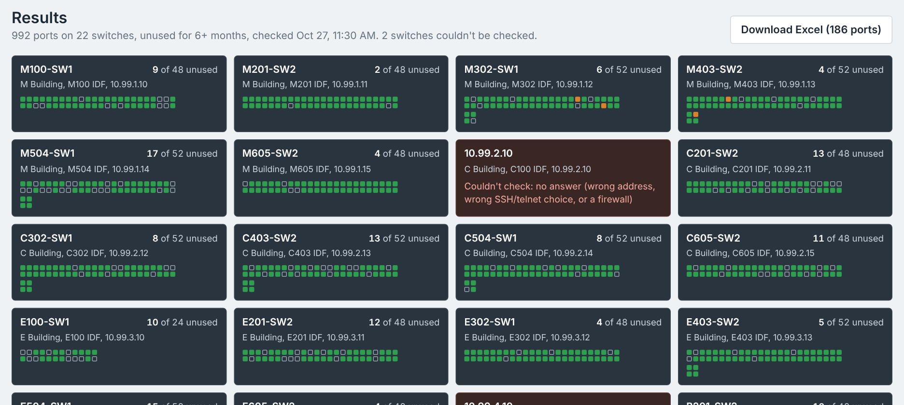

# Port Analyzer

Find switch ports that haven't been used in months, on one switch, one building, or every switch at once, and download the results as an Excel report.

It works with every type of switch on our network: Cisco Catalyst, Cisco Nexus, Dell PowerConnect 5548P and Aruba S3500. It runs on your own computer in your web browser. Nothing is hosted anywhere, and nobody else on the network can reach it.



---

## Install (Windows)

You only do this once.

1. **Install Python 3.12 or newer** from <https://www.python.org/downloads/>.
   On the first installer screen, tick **"Add python.exe to PATH"**.
2. **Get the app**, either way works:
   - With Git, in a Command Prompt:
     ```
     cd %USERPROFILE%\Documents
     git clone https://github.com/JWu-Online/cisco-port-analyzer.git
     ```
   - Without Git: on the [GitHub page](https://github.com/JWu-Online/cisco-port-analyzer), click **Code → Download ZIP** and unzip it.
3. **Double-click `RunAnalyzer.bat`.**
   The first time, it spends a minute or two installing what it needs (it has to reach pypi.org). After that it starts in a few seconds.

Your browser opens to `http://127.0.0.1:5000`. Keep the black window open while you use the app; closing it stops the app.

**Mac or Linux:** run `./start.sh` instead.

If you used the old version, you no longer need to set up the `venv` folder yourself. `RunAnalyzer.bat` makes its own, so you can delete the old `venv` folder.

## Use it

### 1. Add your switches (first time only)
Open **Switch list → Edit switches** and click **Import a file**. Pick a CSV with a header row like this (columns in any order):
```
address,type,protocol,building,location
10.99.0.1,cisco_nxos,ssh,M Building,Main MDF
10.99.4.11,cisco_ios,telnet,C Building,C3 IDF
10.99.4.12,aruba_mas,telnet,M Building,M2 IDF
10.99.4.13,dell_powerconnect,telnet,B Building,B2 IDF
```
This is the same format as Switch Port Finder, so the list you already use there works here too. Click **Save switches**.

You can also **Paste a list** (`address, type, ssh or telnet, location, building`) or **Add a switch** by hand. For the type you can write the model, like `2960x`, `N7k`, `5548P` or `S3500`. Use **Test login** on a row to check its type and login: it reads the switch's ports and tells you how many look unused.

| Type | Use it for |
|---|---|
| `cisco_ios` | Cisco Catalyst: 2960S/X, 3560, 3650, 3750, 4506/4507, 4948, 9200L |
| `cisco_nxos` | Cisco Nexus 7000 and 9000 |
| `dell_powerconnect` | Dell PowerConnect 5500 series: 5524, 5548, 5548P |
| `aruba_mas` | Aruba Mobility Access Switches (ArubaOS): S1500, S2500, S3500 |

### 2. Pick what to check
- **Switches:** every switch, one building, or one switch.
- **Unused for at least:** how many months counts as unused (6 by default).

### 3. Log in and run
Enter your username and password, plus the enable password if your switches ask for one. If the SSH switches (the Nexus cores) use a different login than the telnet switches, tick **SSH switches use a different login**. Click **Check ports**. You can watch each switch being read in the log.

Passwords are only kept in memory for the run. They are never written to disk.

### Reading the results

Every switch is drawn as a small chassis with one light per port:
- **Green**: in use.
- **Empty socket**: unused for at least the months you picked.
- **Amber**: the switch can't tell (see below).

Click a switch to see only its ports. The table below starts on **Inactive** ports. Click **Unsure** or **Active** too, pick a switch or building, or search for a port, description, VLAN or reason.

**Download Excel** saves exactly the ports you're looking at, plus a Summary sheet with one row per switch: ports checked, how many are inactive, how long the switch has been up, and any problems.

| Result | What it means |
|---|---|
| **Inactive** | No use for at least the months you picked. |
| **Unsure** | The switch can't prove it either way. The **Why** column says why. |
| **Active** | The link is up, or the port was used within the months you picked. |

## How it knows when a port was last used

Each type of switch keeps track differently:

| Switch | What the app reads |
|---|---|
| Cisco Catalyst | `show interfaces`: Last input / Last output. A port that's down stops sending, so the newer of the two is when it was last in use. |
| Cisco Nexus | `show interface`: Last link flapped (when a down port went down). |
| Aruba S3500 | `show interface`: link status last changed. |
| Dell 5548P | No timestamp at all. A down port with 0 packets since the switch started hasn't been used since then. A down port that did have traffic is **Unsure**, because the switch doesn't record when. |

"Never used" only reaches back to when the switch last restarted (or its counters were cleared). So a never-used port is only **Inactive** if the switch has been up longer than the months you picked. Otherwise it's **Unsure**, and the reason says how long the switch has been up. The old version called these inactive no matter what.

## Your data

Your switch list, settings, saved reports and any debug output live in the `data` folder next to the app. Git ignores that folder, so none of it ends up on GitHub, and updating the app never touches it.

## Updating

- Cloned with Git: double-click `update.bat` (or run `git pull`).
- Downloaded as a ZIP: download the new ZIP and copy your old `data` folder into it.

## Troubleshooting

**"login failed"**
Wrong username or password, or the switch wants an enable password. If the Nexus cores use a different login, tick **SSH switches use a different login**.

**"no answer"**
Wrong address, the wrong SSH/Telnet choice, or a firewall in the way. Check that you can reach it from your PC with PuTTY using the same settings.

**"Read the switch, but no ports could be read. Is the type right?"**
The app logged in but didn't recognise what the switch printed. The type is usually wrong; try **Test login** with another type. If the type is right, the switch printed something in a layout the app hasn't seen. What it printed is saved in `data\debug\`; send that file to whoever maintains this repo.

**A full run is slow**
Each switch takes a few seconds, and one that doesn't answer waits for the login timeout. Raise **Switches at once** under **More settings** (for example to 20), or check one building.

**RunAnalyzer.bat fails while installing libraries**
It needs to reach pypi.org. If your network uses a proxy, open a Command Prompt in the app folder and run `set HTTPS_PROXY=http://your-proxy:port`, then `RunAnalyzer.bat`.

## Command line

The command line still works, for one switch or the whole list:
```
.venv\Scripts\python analyzer.py 10.99.4.11 -u admin -t cisco_ios -p telnet -m 6
.venv\Scripts\python analyzer.py --list data\switches.csv -u admin -m 6 -o unused.xlsx
```
`-q inactive` (default), `-q active` or `-q all` picks which ports go in the spreadsheet. It asks for the password and enable password.

---

## For maintainers

```
app.py              web app (Flask, served by waitress on 127.0.0.1 only)
analyzer.py         reading each switch type's ports, deciding Inactive/Unsure/Active, the command line
switches.py         logging in over SSH/telnet for each switch type
report.py           the Excel report
templates/, static/ the page
examples/           a made-up switch list
tests/              pretend switches, sample output for each type, an end-to-end test
```

**Run the tests** (no real switches needed). The test starts one pretend switch of each type, plus one with a wrong password and one with the wrong type, and drives the whole app:
```
.venv\Scripts\python tests\test_end_to_end.py
```

**Add a switch type:** in `switches.py`, add it to `TYPES`, `MODELS` and `DRIVERS`. In `analyzer.py`, write a reader that returns each port's status, VLAN, description and when it was last used (or that it was never used, and how far back the switch can see), and add it to `READERS`. Put sample output in `tests/samples.py` and the expected answers next to it.
